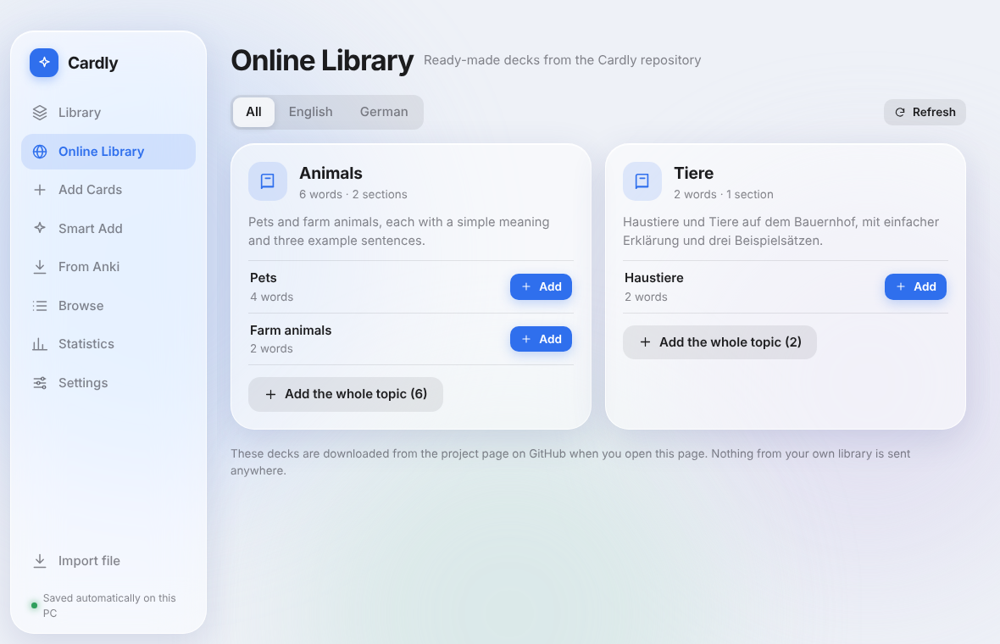
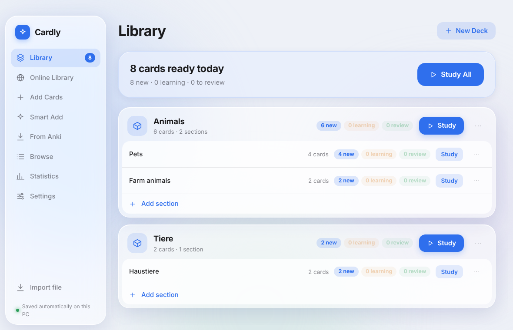
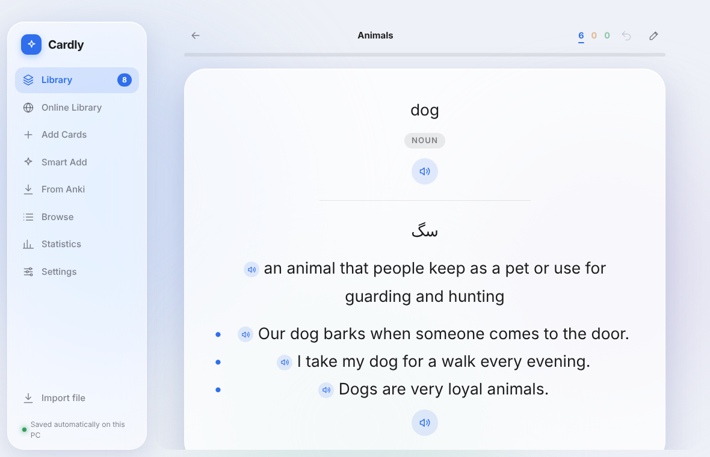
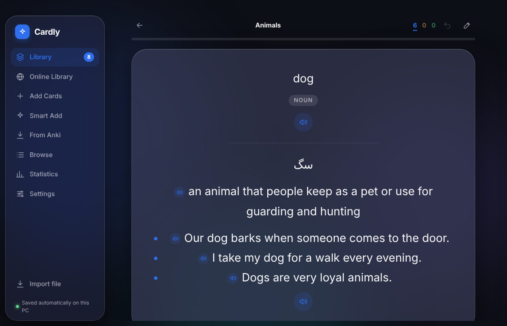

# Cardly

A spaced-repetition flashcard app for Windows. It works like Anki, with a cleaner glass-style interface, offline natural voices, AI-assisted card creation and a one-click move from Anki that keeps your whole review history.

Everything runs on your computer. There is no account and no server. Your cards never leave your PC unless you use the optional AI feature.

## Screenshots





| Light | Dark |
| --- | --- |
|  |  |

## Contents

- [Screenshots](#screenshots)
- [Features](#features)
- [Install](#install)
- [Run from source](#run-from-source)
- [Using the app](#using-the-app)
- [Writing cards](#writing-cards)
- [Importing cards](#importing-cards)
- [Moving everything from Anki](#moving-everything-from-anki)
- [Scheduling methods](#scheduling-methods)
- [Audio and natural voice](#audio-and-natural-voice)
- [Smart Add (cards from a word list)](#smart-add-cards-from-a-word-list)
- [Online Library](#online-library)
- [Optional content packs](#optional-content-packs)
- [Your data](#your-data)
- [Keyboard shortcuts](#keyboard-shortcuts)
- [Building the Windows installer](#building-the-windows-installer)
- [Publishing on GitHub](#publishing-on-github)
- [Project structure](#project-structure)
- [Tests](#tests)
- [License](#license)

## Features

- **Spaced repetition** with four answer buttons (Again, Hard, Good, Easy), learning steps, daily limits and undo.
- **Two scheduling methods:** the classic method (modified SM-2, like Anki) and an optional newer method that adapts to each card (FSRS-6).
- **Decks and sub-decks** nested as deep as you like.
- **Rich cards:** math (KaTeX), bold and italic, small labels, images (paste with Ctrl+V) and audio.
- **Natural voice offline:** a neural English voice (Kokoro) that works without internet, with the Windows voices as a fallback.
- **Smart Add:** paste a list of words and get complete cards (word type, meaning, simple definition, example sentences). Works with any OpenAI-compatible service, or with a free chat site by copy and paste.
- **From Anki:** reads your installed Anki directly and brings cards, deck tree, tags, images, audio, progress, suspended cards and the full review history.
- **Import** from CSV, TSV, TXT and Anki export files (`.apkg`, `.colpkg`).
- **Statistics:** retention, reviews per day, a forecast of due cards, a one-year activity map and streaks.
- **Browse** every card, filter by deck, search the text and open any card in the editor.
- **Four looks** (Glass, Frost, Paper, Midnight), light, dark or automatic mode, custom accent color and fonts, with a separate font option for Persian and Arabic text on cards.
- **Automatic backups** and a one-file backup you can save anywhere.
- **Online Library:** ready-made decks in any language (for example English and German) that you or your friends add to the GitHub repository. Users see new decks without installing a new version.
- **Optional content packs:** drop a file in a folder to add ready-made decks. The app ships without any.

## Install

1. Open the **Releases** page of this repository.
2. Under **Assets** download `Cardly-Setup-<version>.exe` and run it. You can choose the install folder.

The installer is not code-signed, so Windows SmartScreen may show a warning the first time. Click **More info**, then **Run anyway**.

To update, install the newer version over the old one. Your cards and settings stay untouched (see [Your data](#your-data)).

## Run from source

Requirements: Windows, Node.js 20 or newer.

```
npm install
npm start
```

Notes for Windows:

- If PowerShell says that running scripts is disabled, use `npm.cmd` instead of `npm` (for example `npm.cmd install`).
- Newer npm versions print a warning that two packages have install scripts that are not approved yet. Electron needs its script to download itself, so approve both once, then rebuild:

```
npm install-scripts approve electron
npm install-scripts approve electron-winstaller
npm rebuild
```

## Using the app

| Page | What it does |
| --- | --- |
| **Library** | All decks with the number of new, learning and review cards. Start studying a deck from here. A deck can be renamed, given a section (sub-deck), exported as CSV and deleted. |
| **Add Cards** | Create cards by hand with the editor (front, back, tags, images, formulas). |
| **Smart Add** | Make many cards at once from a list of words. |
| **From Anki** | Move your whole Anki collection, including progress. |
| **Browse** | Search and open every card. |
| **Statistics** | Charts for the last 30 days, the next 14 days, retention and a yearly activity map. |
| **Settings** | Appearance, study options, audio, AI connection, backup and data folder. |
| **Import file** | Add cards from a CSV, TXT or Anki file (bottom of the sidebar). |
| **Online Library** | Decks downloaded from the project's GitHub repository, by language (see [Online Library](#online-library)). Appears only when the repository is set in `package.json`. |
| **Starter Packs** and **Word Topics** | Appear in the sidebar only when pack files exist (see [Optional content packs](#optional-content-packs)). |

While studying you see the front of a card, press **Show Answer**, then choose how well you remembered it. The buttons show when the card will come back.

A card can be **suspended** in the editor. A suspended card is kept but never shown in study. **Reset progress** turns a card back into a new card.

## Writing cards

| Write | Result |
| --- | --- |
| `$x^2$` | inline formula |
| `$$\frac{a}{b}$$` | display formula |
| `**text**` and `*text*` | bold and italic |
| `~~noun~~` | small label, for example a word type |
| `` `code` `` | code |
| `- item` | bullet list |
| `` | image (pasting with Ctrl+V adds it for you) |
| `[sound:file.mp3]` | a play button for an audio file |

All text is escaped before it is shown, so cards can never run HTML or scripts. Each line takes its text direction from its first letter, so mixed Persian and English cards read correctly.

## Importing cards

**CSV, TSV and TXT.** Column one is the front, column two is the back and column three (optional) is the tags. The separator and a header row are detected automatically. Excel files saved in the old Persian encoding (windows-1256) are recognized. An example is in `samples/example.csv`.

**Anki text exports** (tab separated, with HTML and a tags column) are understood too.

**Anki packages** (`.apkg`, `.colpkg`, old and new format) can be imported with **Import file**. This path brings cards only. To keep progress, use **From Anki**.

## Moving everything from Anki

Open **From Anki** in the sidebar. Cardly finds the Anki installed on this computer and brings:

- cards, decks and sub-decks (same structure) and tags
- images and audio (a play button appears on the card)
- the progress of every card: next review date, interval, ease, reviews and lapses
- suspended cards
- the complete review history, so statistics, the activity map and streaks are filled in

Steps:

1. Close Anki so the file is complete.
2. In Cardly open **From Anki** and choose your profile (**Read this profile**).
3. Pick the decks you want and the options, then press **Import**.

Notes:

- Nothing is ever written to Anki. Only a copy of the file is read.
- You can read again later. Cards are matched by their Anki id, so nothing is added twice and history is not counted twice.
- If no profile is found, use **Choose a collection file**. It is usually here:

```
C:\Users\NAME\AppData\Roaming\Anki2\User 1\collection.anki2
```

- Export files (`.apkg`, `.colpkg`, including the newest `anki21b` format) can be opened from the same page with **Open an export**.
- Next review dates are calculated with Cardly's study day (the day start hour is in Settings). They can differ from Anki by about one day.

## Scheduling methods

Choose in **Settings › Study › Scheduling method**.

- **Classic** (default): the familiar rule. Intervals grow by a factor that depends on the card's ease and on your answer.
- **New (per card)**: the model tracks how stable your memory of each card is and how hard the card is for you. The intervals are then set per card. You press the same four buttons and do nothing else.

Existing cards keep their dates. The new method takes over from a card's next review, and for cards that came from Anki the difficulty is estimated from their ease. You can switch back at any time.

The **Advanced** section (only shown when the new method is on) has **Target memory**. The default of 90 is a good value for nearly everyone.

The new method follows the published FSRS-6 formulas with the default parameters. It has been checked against an independent calculation, but not against the official test vectors, so results may differ slightly from other FSRS programs.

## Audio and natural voice

Every card has a speaker button. Use **R** to read the current card, **Auto-play** to read automatically, and choose voice and speed in **Settings › Audio**.

**Windows voices** work offline. For better quality install an English voice: *Windows Settings › Time & language › Speech › Manage voices › Add voices*.

**Natural voice (Kokoro)** is a neural voice that runs fully offline. It needs a one-time setup:

1. The two voice packages are already listed in `package.json` and install with `npm install` (the exact versions matter).
2. Download the voice model (about 330 MB):

```
https://github.com/k2-fsa/sherpa-onnx/releases/download/tts-models/kokoro-en-v0_19.tar.bz2
```

3. Extract it so you get a folder named `kokoro-en-v0_19`.
4. In the app: **Settings › Audio › Voice engine › Natural (offline)**, press **Voices folder**, put the extracted folder inside, then press **Check again**.

The installers published by the GitHub workflow already contain this model, so people who install Cardly from a Release do not need to do any of this. A model the user puts in the voices folder is used instead of the built-in one.

If something is missing the app says what, and falls back to the Windows voice. Sentences you have heard once are cached and play instantly next time.

To test the engine outside the app:

```
node tools/voice-check.js
```

## Smart Add (cards from a word list)

Paste a list of words, choose how many example sentences you want, and Cardly builds one card per word with the word type, a Persian meaning (optional), a simple definition and example sentences. You can review the result and remove any card before saving.

Two ways to use it:

1. **AI connection.** In **Settings › AI connection** choose a service and enter your key. DeepSeek is a ready preset. Any service that follows the OpenAI format works, such as OpenRouter, Groq, OpenAI, or a local model through Ollama. The key stays on this computer and is not included in backups.
2. **Copy and paste (no key).** The app gives you a ready request. Paste it into any AI chat, then paste the answer back.

## Online Library

The **Online Library** page shows ready-made decks that live in the `library` folder of this GitHub repository. The app downloads them when the page is opened, so a deck added to GitHub is available to everyone without a new installer.

- Decks are grouped by language (English, German, ...). Open a topic and press **Add** next to one section at a time, or add the whole topic. Adding again never creates duplicates.
- Cards remember their language, so German cards are read aloud with a German Windows voice. (The natural offline voice is English only. A German voice can be added in *Windows Settings › Time & language › Speech › Manage voices*.)
- The last downloaded copy is saved, so the page also works offline.
- The app only reads from GitHub. Nothing from your own cards is sent.

**For the person who runs the repository**

1. Make the repository public and add this line to `package.json` (use your own names):

```
"repository": "github:YOUR-NAME/YOUR-REPOSITORY",
```

   Without this line the page is hidden. Build and publish a new version once after adding it.
2. Add content files to the `library` folder. The format, the examples and the way to work together (for example with a friend who writes German) are explained in `library/README.md`.
3. A workflow rebuilds `library/index.json` after every change, and checks files sent as pull requests. You can also run the check yourself:

```
npm run library
```

## Optional content packs

The app ships **empty**. It has no built-in decks. If you want ready-made content, add files to `src/packs/`. The sidebar entries **Starter Packs** and **Word Topics** appear only when at least one matching file exists, so a build without packs shows neither page.

Files whose name starts with `_` are ignored. Two documented examples are included:

- `src/packs/_example-pack.js`: a plain pack. Copy it to `src/packs/yourname.js`.
- `src/packs/_example-topic.js`: a word topic with sections. Copy it to `src/packs/topic-yourname.js` (the name must start with `topic-`).

A topic row is one word:

```
[word, part of speech, Persian meaning, definition, example 1, example 2, example 3]
```

On the **Word Topics** page every topic lists its sections. You add one section at a time (for example Animals › Pets) and study just that section, or add the whole topic. Adding again never creates duplicates, and new words you add to a file later are picked up with the **Add the rest** button.

## Your data

Everything is stored in your Windows user folder, not in the program folder:

```
%APPDATA%\Cardly
```

| Item | Purpose |
| --- | --- |
| `data.json` | decks, cards, history and settings |
| `media/` | images and audio used by cards |
| `backups/` | one automatic backup per day, the last 10 are kept |
| `voices/` | natural voice models you downloaded |

Installing a new version, or uninstalling the app, does not delete this folder. To start completely fresh, close the app and delete it. To move to another computer, use **Settings › Data › Backup** and import the file there.

## Keyboard shortcuts

| Key | Action |
| --- | --- |
| Space / Enter | Show the answer, then answer "Good" |
| 1 to 4 | Again, Hard, Good, Easy |
| R | Read the card aloud |
| Ctrl+Z | Undo the last answer |
| E | Edit the card |
| Esc | Leave study |
| Ctrl+N | Add a card |

## Building the Windows installer

```
npm install
npm run dist
```

The result is in the `dist` folder: `Cardly-Setup-<version>.exe`. Without a bundled voice model a portable file (`Cardly-Portable-<version>.exe`) is built as well. The icon is `build/icon.ico`. Replace it with your own file to change it. Build settings are in `electron-builder.config.js`.

### Including the natural voice in the installer

By default the installer is small and does not contain the voice model. To include it:

1. Create a folder named `bundled-voices` in the project folder.
2. Put the extracted `kokoro-en-v0_19` folder inside it (see [Audio and natural voice](#audio-and-natural-voice)).
3. Run `npm run dist` again. The build prints that it found the model.

The installer becomes about 400 MB bigger and only the normal installer is built (a portable file would have to unpack that much on every start). The `bundled-voices` folder is not uploaded to GitHub; the GitHub workflow downloads the model itself when it builds a release. To publish a small installer instead, delete the "Download the natural voice model" step from `.github/workflows/release.yml`.

## Publishing on GitHub

Create an empty repository, then in the project folder:

```
git init
git add .
git commit -m "Cardly"
git branch -M main
git remote add origin <repository-url>
git push -u origin main
```

To build the installer on GitHub automatically, push a version tag:

```
git tag v1.0.0
git push origin v1.0.0
```

The workflow in `.github/workflows/release.yml` runs the tests, builds the installer on a Windows machine and attaches the `.exe` files to a GitHub Release. You can also start it by hand from the **Actions** tab.

Before each new release raise the `version` number in `package.json`. To show the Online Library in the app, add the `repository` line described in [Online Library](#online-library) first.

`node_modules/`, `dist/` and your personal data are not part of the repository.

## Project structure

```
main.js                 Electron main process: window, storage, backups, IPC
preload.js              the safe bridge between the window and the main process
renderer/               the interface
  index.html              page shell and security policy
  app.js                  all views and interactions
  render.js               card text to safe HTML (math, markup, images, sound)
  speech.js               reading text aloud (Windows voices and natural voice)
  styles.css              all styling and the four looks
src/
  sm2.js                  classic scheduling and the study queue
  fsrs.js                 formulas of the new scheduling method
  importers.js            CSV, TXT and Anki package import
  html.js                 Anki HTML to Cardly text
  anki.js                 reading an Anki collection: decks, templates, progress, history
  ankidb.js               opening the Anki database (sql.js)
  ankipkg.js              reading .apkg and .colpkg packages
  ankilive.js             finding and reading the Anki installed on this computer
  anki-worker.js          runs the Anki reading in a separate process
  smartadd.js             building the AI request and reading the reply
  aiclient.js             talking to OpenAI-compatible services
  looks.js                the looks and accent colors
  tts-core.js             natural voice logic (finding the model, making audio)
  tts-worker.js           runs the voice engine in a separate process
  topicpack.js            builds word-topic packs from compact rows
  library.js              online library: address, checking files, loading with a saved copy
  packs/                  optional content packs (empty, with two examples)
LICENSE                 terms of use (all rights reserved)
THIRD-PARTY-NOTICES.md  licenses of the libraries and voice model Cardly uses
docs/screenshots/       pictures used in this README
samples/example.csv     a small file to try importing
tools/voice-check.js    tests the natural voice outside the app
tools/build-library-index.js  checks the library files and builds library/index.json
library/                content of the Online Library (see library/README.md)
test/                   automated tests
build/icon.*            application icon
electron-builder.config.js  installer settings (adds the voice model when bundled-voices exists)
.github/workflows/      automatic installer build and library index
```

## Tests

```
npm test
```

The tests cover scheduling, card rendering, importing, the Anki reader (with generated test collections in both Anki database layouts), the AI request and reply handling, the natural voice logic, word-topic pack rules and the online library (checking files, loading with and without internet, the index tool).

## License

Copyright © 2026 Mohammad Javad Arabi. All rights reserved.

The source code is published so that people can read it and use the app. It is **not** open source: you may not copy, modify, redistribute or sell the code or the app without written permission. The exact terms are in [LICENSE](LICENSE).

Cardly uses open-source libraries and a voice model that keep their own licenses. They are listed in [THIRD-PARTY-NOTICES.md](THIRD-PARTY-NOTICES.md).
